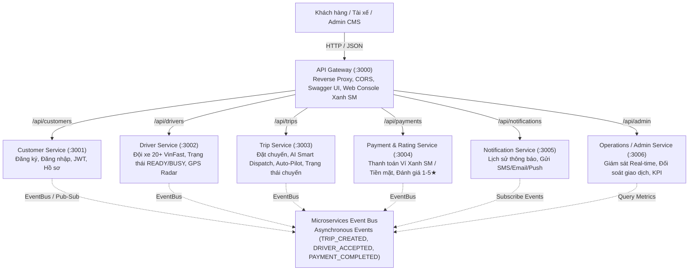

# ⚡ XANH SM – HỆ THỐNG ĐẶT XE ĐIỆN THÔNG MINH (MICROSERVICES)

Dự án triển khai kiến trúc **Microservices** cho hệ thống đặt xe điện thông minh theo mô hình **Xanh SM (GSM - Green Smart Mobility)**, dựa trên tài liệu đặc tả yêu cầu nghiệp vụ SRS (`srs.md`), các đặc tả OpenAPI 3.0 (`API document/`) và bộ kịch bản kiểm thử (`TestCase/`).

---

## 🌟 Các Tính Năng Đột Phá Chuẩn Xanh SM

1. **Đội xe điện VinFast phong phú (20+ xe trực tuyến)**:
   - **Xanh SM Bike**: VinFast Feliz S, VinFast Evo 200, VinFast Klara S (xe máy điện êm ái, tiết kiệm).
   - **Xanh SM Taxi**: VinFast VF 5 Plus, VinFast VF e34 (ô tô 4 chỗ tiêu chuẩn, máy lạnh mát rượi, không mùi xăng xe).
   - **Xanh SM Luxury**: VinFast VF 8, VinFast VF 9 (SUV điện sang trọng đẳng cấp VIP).
   - Quản lý định vị GPS tọa độ thực tế khắp TP.HCM (Quận 1, Quận 3, Landmark 81, Sân bay Tân Sơn Nhất, Crescent Mall Q.7, Thủ Đức...) kèm thông số pin (`batteryLevel %`).
2. **Thuật toán điều phối AI Smart Dispatch**:
   - Tự động tính khoảng cách thực tế giữa điểm đón và các tài xế xung quanh theo công thức **Haversine GPS** (`latitude`, `longitude`).
   - Sắp xếp và tự động gán chuyến cho tài xế gần nhất với thời gian đón (ETA) tối ưu nhất.
3. **Chế độ Auto-Pilot (Tự động hóa hoàn toàn luồng đặt xe)**:
   - Khi khách bấm đặt chuyến, hệ thống tự động tìm tài xế gần nhất -> Tự động nhận chuyến trong 1.5s -> Mô phỏng hành trình di chuyển thực tế (Đến điểm đón → Đón khách → Di chuyển → Hoàn thành) -> Hiện thông báo thanh toán và đánh giá sao.
4. **Theo dõi giảm phát thải CO2**:
   - Tự động tính toán lượng khí thải CO2 cắt giảm được trên mỗi km di chuyển bằng xe điện so với xe xăng truyền thống.
5. **Bản đồ Radar Trực Tuyến**:
   - Giao diện Dashboard hiển thị radar theo dõi 20 xe điện VinFast theo thời gian thực.

---

## 🏗️ 1. Tổng quan Kiến trúc Hệ thống

Hệ thống được thiết kế theo chuẩn phân rã Domain-Driven Design (DDD) thành **6 Microservices độc lập** cùng **1 API Gateway** thống nhất:



---

## 📦 2. Danh mục Microservices & Cổng Dịch Vụ

| Service | Port | Database (Database-per-Service) | Trách nhiệm chính & Use Case | OpenAPI Spec |
|---|:---:|---|---|---|
| **API Gateway** | `3000` | In-memory Routing Cache | Điểm vào duy nhất (Single Entry Point), Reverse proxy, Web Dashboard Xanh SM, Swagger UI | `Customer.yaml`, `Driver.yaml`, `Trip.yaml`, `Payment.yaml`, `Notification.yaml`, `Operations.yaml` |
| **Customer Service** | `3001` | `data/customers.db` (SQLite) | Đăng ký khách hàng (UC01), Đăng nhập (UC02), Cấp JWT token, Quản lý tài khoản | `API document/Customer.yaml` |
| **Driver Service** | `3002` | `data/drivers.db` (SQLite) | Đội xe 20+ tài xế VinFast, Trạng thái READY/BUSY/OFFLINE (UC11, BRL04), Danh sách phương tiện (UC17), Tìm tài xế gần nhất theo GPS | `API document/Driver.yaml` |
| **Trip Service** | `3003` | `data/trips.db` (SQLite) | Đặt chuyến xe (UC04), AI Dispatch tìm tài xế gần nhất, Tính cước Xanh SM (E08), Accept/Reject (UC13, UC14), Chuyển trạng thái (UC15), Hủy chuyến (AC14) | `API document/Trip.yaml` |
| **Payment & Rating Service** | `3004` | `data/payments.db` (SQLite) | Thanh toán Ví điện tử Xanh SM / Tiền mặt (UC19, UC20, BRL16), Đánh giá 1-5 sao kèm nhận xét (UC22, AC07.5) | `API document/Payment.yaml` |
| **Notification Service** | `3005` | `data/notifications.db` (SQLite) | Lịch sử thông báo (UC24, FR37-FR42), Tự động gửi thông báo theo thời gian thực qua sự kiện | `API document/Notification.yaml` |
| **Operations Service** | `3006` | `data/operations.db` (SQLite) | Giám sát chuyến xe thời gian thực (UC28, AC08.5), Tra cứu đối soát giao dịch (UC30), Phân quyền Admin/Operator (E14, E15) | `API document/Operations.yaml` |

---

## 💡 3. Các Nguyên Tắc & Design Patterns Áp Dụng

1. **Database per Service Pattern**: Mỗi microservice sở hữu cơ sở dữ liệu quan hệ SQL riêng biệt (`node:sqlite` tích hợp sẵn trong Node.js), đảm bảo tính đóng gói (encapsulation) và độc lập dữ liệu tuyệt đối, không chia sẻ trực tiếp database giữa các service.
2. **API Gateway Pattern**: Client không cần biết địa chỉ port của từng service. Mọi tương tác đi qua cổng `3000` được định tuyến tự động.
3. **Event-Driven Architecture (EDA)**: Giao tiếp bất đồng bộ qua `EventBus` giúp các service phản ứng với sự kiện mà không bị phụ thuộc cứng (loose coupling):
   - `TRIP_CREATED`: Notification Service gửi thông báo cho khách và tài xế ứng viên.
   - `DRIVER_ACCEPTED`: Driver Service chuyển trạng thái tài xế sang `BUSY`.
   - `TRIP_COMPLETED`: Kích hoạt yêu cầu tính cước và thanh toán.
   - `PAYMENT_COMPLETED`: Driver Service tự động chuyển trạng thái tài xế về lại `READY`.
4. **AI Smart Dispatch**: Sử dụng công thức Haversine để tính khoảng cách và tự động phân phối chuyến cho tài xế VinFast gần nhất.
5. **Zero-install Dependency Friction**: Sử dụng toàn bộ module chuẩn của Node.js (`node:http`, `node:sqlite`, `node:crypto`, `node:test`, `node:assert`), không lo lắng lỗi `node_modules` hay thiếu compiler C++ trên Windows.

---

## 🚀 4. Hướng dẫn Cài đặt & Khởi chạy

### Yêu cầu môi trường
- **Node.js**: Phiên bản 22+ (Khuyên dùng v26+)

### Cách 1: Khởi chạy tất cả Microservices (Khuyên dùng)
```bash
node start-all.js
# Hoặc:
npm start
```

Khi chạy thành công, truy cập:
- 🌐 **Web Dashboard Xanh SM Trực Quan**: [http://localhost:3000/](http://localhost:3000/)
- 📖 **OpenAPI / Swagger Explorer**: [http://localhost:3000/docs](http://localhost:3000/docs)
- 🩺 **Kiểm tra trạng thái Microservices**: [http://localhost:3000/health](http://localhost:3000/health)

### Cách 2: Khởi chạy bằng Docker Compose
```bash
docker compose up --build
```

---

## 🧪 5. Kiểm thử Tự động (Automated Test Suite)

Dự án cung cấp bộ kiểm thử toàn diện gồm **34 test cases** tương ứng 100% với tài liệu đặc tả và các tính năng nâng cao:

```bash
npm test
# Hoặc:
node --test tests/*.test.js
```

**Kết quả kiểm thử thực tế:**
```text
✔ Customer Service Tests (UC01, UC02) - 5/5 PASSED
✔ Driver Service Tests (UC11, UC17, Xanh SM Fleet) - 6/6 PASSED
✔ Trip Service Tests (UC04, UC13, UC14, UC15) - 4/4 PASSED
✔ Payment & Rating Service Tests (UC19, UC20, UC22) - 4/4 PASSED
✔ Notification Service Tests (UC24, FR37-FR42) - 2/2 PASSED
✔ Operations Service Tests (UC28, UC30) - 3/3 PASSED
✔ Full End-to-End Microservices Integration Workflow (Xanh SM) - 10/10 PASSED

ℹ tests 34
ℹ suites 7
ℹ pass 34
ℹ fail 0
```

---

## 👨‍💻 Thông tin Sinh viên / Tác giả
- **MSSV**: `23704171`
- **Họ và tên**: Nguyễn Hồ Thảo Nguyên
- **Dự án**: CAB SYSTEM – XANH SM (Kiến trúc Microservices)
