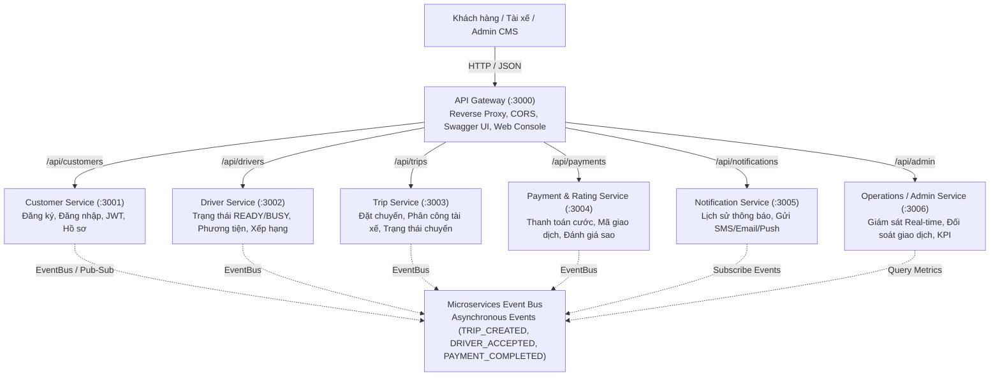

# 🚖 CAB SYSTEM – KIẾN TRÚC MICROSERVICES

Dự án triển khai kiến trúc **Microservices** cho hệ thống đặt xe trực tuyến **CAB System** dựa trên tài liệu đặc tả yêu cầu nghiệp vụ SRS (`srs.md`), các đặc tả OpenAPI 3.0 (`API document/`) và bộ kịch bản kiểm thử (`TestCase/`).

---

## 🏗️ 1. Tổng quan Kiến trúc Hệ thống

Hệ thống được thiết kế theo chuẩn phân rã Domain-Driven Design (DDD) thành **6 Microservices độc lập** cùng **1 API Gateway** thống nhất:



---

## 📦 2. Danh mục Microservices & Cổng Dịch Vụ

| Service | Port | Database (Database-per-Service) | Trách nhiệm chính & Use Case | OpenAPI Spec |
|---|:---:|---|---|---|
| **API Gateway** | `3000` | In-memory Routing Cache | Điểm vào duy nhất (Single Entry Point), Reverse proxy, Web Dashboard, Swagger UI | `Customer.yaml`, `Driver.yaml`, `Trip.yaml`, `Payment.yaml`, `Notification.yaml`, `Operations.yaml` |
| **Customer Service** | `3001` | `data/customers.db` (SQLite) | Đăng ký khách hàng (UC01), Đăng nhập (UC02), Cấp JWT token, Quản lý tài khoản | `API document/Customer.yaml` |
| **Driver Service** | `3002` | `data/drivers.db` (SQLite) | Trạng thái sẵn sàng READY/BUSY/OFFLINE (UC11, BRL04), Danh sách phương tiện (UC17), Loại xe | `API document/Driver.yaml` |
| **Trip Service** | `3003` | `data/trips.db` (SQLite) | Đặt chuyến xe (UC04), Tính cước cơ bản (E08), Phân công tài xế (UC07, E07), Accept/Reject (UC13, UC14), Chuyển trạng thái (UC15), Hủy chuyến (AC14) | `API document/Trip.yaml` |
| **Payment & Rating Service** | `3004` | `data/payments.db` (SQLite) | Xử lý thanh toán Tiền mặt / Điện tử (UC19, UC20, BRL16), Đánh giá tài xế 1-5 sao (UC22, AC07.5) | `API document/Payment.yaml` |
| **Notification Service** | `3005` | `data/notifications.db` (SQLite) | Lịch sử thông báo (UC24, FR37-FR42), Tự động gửi thông báo theo thời gian thực qua sự kiện | `API document/Notification.yaml` |
| **Operations Service** | `3006` | `data/operations.db` (SQLite) | Giám sát chuyến xe thời gian thực (UC28, AC08.5), Tra cứu đối soát giao dịch (UC30), Phân quyền Admin/Operator (E14, E15) | `API document/Operations.yaml` |

---

## 💡 3. Các Nguyên Tắc & Design Patterns Áp Dụng

1. **Database per Service Pattern**: Mỗi microservice sở hữu cơ sở dữ liệu quan hệ SQL riêng biệt (`node:sqlite` tích hợp sẵn trong Node.js), đảm bảo tính đóng gói (encapsulation) và độc lập dữ liệu tuyệt đối, không chia sẻ trực tiếp database giữa các service.
2. **API Gateway Pattern**: Client không cần biết địa chỉ port của từng service. Mọi tương tác đi qua cổng `3000` được định tuyến tự động.
3. **Event-Driven Architecture (EDA)**: Giao tiếp bất đồng bộ qua `EventBus` giúp các service phản ứng với sự kiện mà không bị phụ thuộc cứng (loose coupling):
   - `TRIP_CREATED`: Notification Service gửi thông báo cho khách và tài xế ứng viên.
   - `DRIVER_ACCEPTED`: Driver Service chuyển trạng thái tài xế sang `BUSY`.
   - `TRIP_COMPLETED`: Kích hoạt yêu cầu tính cước và thanh toán.
   - `PAYMENT_COMPLETED`: Driver Service tự động chuyển trạng thái tài xế về lại `READY`.
4. **Resilience & Fault Tolerance**: Khi một service tạm thời gián đoạn, API Gateway trả về thông báo lỗi 502 Bad Gateway chi tiết mà không làm sập toàn bộ hệ thống.
5. **Zero-install Dependency Friction**: Sử dụng toàn bộ module chuẩn của Node.js (`node:http`, `node:sqlite`, `node:crypto`, `node:test`, `node:assert`), không lo lắng lỗi `node_modules` hay thiếu compiler C++ trên Windows.

---

## 🚀 4. Hướng dẫn Cài đặt & Khởi chạy

### Yêu cầu môi trường
- **Node.js**: Phiên bản 22+ (Khuyên dùng v26+)

### Cách 1: Khởi chạy tất cả Microservices (Khuyên dùng)
Chỉ với 1 câu lệnh duy nhất:
```bash
node start-all.js
# Hoặc:
npm start
```

Khi chạy thành công, toàn bộ 6 microservices và API Gateway sẽ sẵn sàng:
- 🌐 **Web Dashboard điều khiển trực quan**: [http://localhost:3000/](http://localhost:3000/)
- 📖 **OpenAPI / Swagger Explorer**: [http://localhost:3000/docs](http://localhost:3000/docs)
- 🩺 **Kiểm tra trạng thái Microservices**: [http://localhost:3000/health](http://localhost:3000/health)

### Cách 2: Khởi chạy bằng Docker Compose
Nếu máy có cài đặt Docker & Docker Desktop:
```bash
docker compose up --build
```

### Cách 3: Khởi chạy từng Microservice riêng lẻ
Bạn có thể mở từng terminal để chạy độc lập từng service:
```bash
node services/customer-service/src/index.js      # Port 3001
node services/driver-service/src/index.js        # Port 3002
node services/trip-service/src/index.js          # Port 3003
node services/payment-service/src/index.js       # Port 3004
node services/notification-service/src/index.js  # Port 3005
node services/operations-service/src/index.js    # Port 3006
node services/api-gateway/src/server.js          # Port 3000
```

---

## 🧪 5. Kiểm thử Tự động (Automated Test Suite)

Dự án cung cấp bộ kiểm thử toàn diện gồm **32 test cases** tương ứng 100% với tài liệu `CABSystem_TestCases (2).xlsx` và `srs.md`:

```bash
npm test
# Hoặc:
node --test tests/*.test.js
```

### Danh mục Test Suite:
1. `tests/customer.test.js`: Đăng ký tài khoản (UC01), Đăng nhập (UC02), Kiểm tra trùng SĐT/Email, Xác thực JWT token.
2. `tests/driver.test.js`: Cập nhật trạng thái READY/BUSY/OFFLINE (UC11), Quản lý phương tiện (UC17), Tìm tài xế phù hợp loại xe.
3. `tests/trip.test.js`: Đặt chuyến (UC04), Tài xế Accept/Reject (UC13/UC14), Tiến trình trạng thái Searching → DriverAccepted → DriverArrived → PassengerPickedUp → InProgress → Completed (BRL11, UC15).
4. `tests/payment.test.js`: Thanh toán chuyến xe (UC19, UC20, BRL16), Sinh mã TransactionCode, Đánh giá sao 1-5 sao (UC22).
5. `tests/notification.test.js`: Truy vấn thông báo (UC24, FR37-FR42).
6. `tests/operations.test.js`: Giám sát chuyến xe thời gian thực (UC28), Đối soát thanh toán (UC30).
7. `tests/e2e-flow.test.js`: Kịch bản tích hợp xuyên suốt toàn bộ luồng nghiệp vụ từ Gateway đến 6 service.

**Kết quả kiểm thử:**
```text
✔ Customer Service Tests (UC01, UC02) - 5/5 PASSED
✔ Driver Service Tests (UC11, UC17) - 4/4 PASSED
✔ Trip Service Tests (UC04, UC13, UC14, UC15) - 4/4 PASSED
✔ Payment & Rating Service Tests (UC19, UC20, UC22) - 4/4 PASSED
✔ Notification Service Tests (UC24, FR37-FR42) - 2/2 PASSED
✔ Operations Service Tests (UC28, UC30) - 3/3 PASSED
✔ Full End-to-End Microservices Integration Workflow - 10/10 PASSED

ℹ tests 32
ℹ suites 7
ℹ pass 32
ℹ fail 0
```

---

## 🖥️ 6. Giao diện Trực quan (Web Dashboard)

Mở trình duyệt tại [http://localhost:3000/](http://localhost:3000/) để trải nghiệm trực quan:
- **Đèn trạng thái (Health Status)** theo dõi sức khỏe từng microservice thời gian thực.
- **Khách hàng đặt xe**: Chọn loại xe (2 bánh, 4 bánh, 7 bánh), nhập lộ trình, bấm đặt chuyến.
- **Tài xế nhận chuyến**: Bật/tắt trạng thái READY, chấp nhận/từ chối chuyến xe được phân công, bấm cập nhật tiến trình chuyến.
- **Thanh toán & Đánh giá**: Thanh toán cước bằng Tiền mặt hoặc Điện tử, đánh giá sao kèm nhận xét.
- **Operations CMS**: Giám sát danh sách chuyến xe và doanh thu thời gian thực.
- **Microservices Event Stream**: Theo dõi log sự kiện Pub/Sub được bắn qua lại giữa các service.

---

## 👨‍💻 Thông tin Sinh viên / Tác giả
- **MSSV**: `23704171`
- **Họ và tên**: Nguyễn Hồ Thảo Nguyên
- **Dự án**: CAB SYSTEM (Phân tích, thiết kế & hiện thực hóa kiến trúc Microservice)
