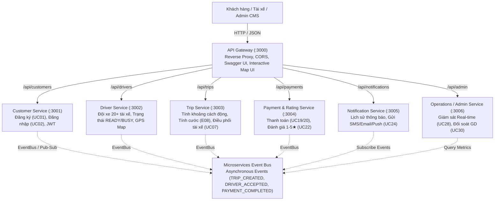

# 🚖 CAB SYSTEM – NỀN TẢNG ĐẶT XE CÔNG NGHỆ THÔNG MINH (MICROSERVICES)

Dự án triển khai kiến trúc **Microservices** cho hệ thống đặt xe công nghệ trực tuyến **CAB SYSTEM**, dựa trên tài liệu đặc tả yêu cầu nghiệp vụ SRS (`srs.md`), các đặc tả OpenAPI 3.0 (`API document/`) và bộ kịch bản kiểm thử (`TestCase/`).

---

## 🌟 Các Tính Năng Nghiệp Vụ & Kỹ Thuật Nổi Bật

1. **Tính Khoảng Cách Lộ Trình Động (Dynamic Geocoding & Distance Calculation)**:
   - Tích hợp công cụ định vị địa lý (`shared/geo-helper.js`): Người dùng có thể **nhập bất kỳ địa chỉ đón và đến nào** (hoặc chọn gợi ý / click trực tiếp trên bản đồ).
   - Hệ thống tự động phân tích địa chỉ, quy đổi tọa độ GPS và áp dụng công thức **Haversine có bù trừ độ uốn khúc đường bộ thực tế (Road Circuity Factor ~ 1.25x - 1.35x)** để tính ra **khoảng cách lái xe thực tế chính xác (km)**.
   - Khoảng cách thay đổi tự động ngay khi người dùng gõ phím, kéo theo giá cước được cập nhật trực tiếp theo thời gian thực.
2. **Cước Phí Phụ Thuộc Chặt Chẽ Vào Khoảng Cách (Business Rule E08 & BRL12)**:
   - Giá cước được tính toán tự động dựa trên công thức quy định:
     $$\text{Tổng cước} = \text{Giá mở cửa (2km đầu)} + \max(0, \text{Khoảng cách} - 2) \times \text{Đơn giá/km}$$
   - Hỗ trợ 3 phân hạng phương tiện:
     - **Cab Bike**: 12.000đ mở cửa + 5.000đ/km tiếp theo.
     - **Cab Car 4-Chỗ**: 20.000đ mở cửa + 12.000đ/km tiếp theo.
     - **Cab Car 7-Chỗ**: 28.000đ mở cửa + 16.000đ/km tiếp theo.
3. **Bản Đồ OpenStreetMap / Leaflet Tương Tác Trực Tuyến**:
   - Giao diện Dashboard tích hợp bản đồ số thời gian thực:
     - 🟢 Điểm đón (Green Marker) và 🔴 Điểm đến (Red Marker).
     - Đường polyline lộ trình trực quan nối giữa hai điểm.
     - Hiển thị vị trí thực của **20+ tài xế** đang hoạt động khắp TP.HCM.
4. **Điều Phối Tài Xế Tự Động (AI Smart Dispatch)**:
   - Tự động quét và phân công chuyến đi cho tài xế ở trạng thái `READY` có khoảng cách gần điểm đón nhất.
   - Hỗ trợ chế độ Auto-Dispatch mô phỏng toàn bộ tiến trình vòng đời chuyến xe:
     `Searching` → `DriverAccepted` → `DriverArrived` → `PassengerPickedUp` → `InProgress` → `Completed`.
   - Cơ chế Auto-Cascade: Nếu tài xế từ chối hoặc hết giờ, hệ thống tự động chuyển tiếp sang tài xế thứ 2, thứ 3 tiếp theo (SRS `EX06`, `EX07`).
5. **Logic Nghiệp Vụ Chặt Chẽ Tại Backend**:
   - Chỉ cho phép thanh toán khi chuyến đi đã ở trạng thái `Completed` (`BRL12`).
   - Ngăn chặn thanh toán trùng lặp cho cùng một chuyến đi (`BRL16`).
   - Chỉ cho phép đánh giá tài xế khi chuyến đi đã hoàn thành (`BRL14`), điểm đánh giá bắt buộc từ 1 đến 5 sao (`AC07.5`).
   - Khi tài xế nhận chuyến, trạng thái chuyển thành `BUSY` (`BRL10`); khi thanh toán hoàn tất hoặc chuyến bị hủy, tài xế tự động chuyển về `READY`.

---

## 🏗️ 1. Tổng quan Kiến trúc Hệ thống

Hệ thống được thiết kế theo chuẩn phân rã Domain-Driven Design (DDD) thành **6 Microservices độc lập** cùng **1 API Gateway** thống nhất:



---

## 📦 2. Danh mục Microservices & Cổng Dịch Vụ

| Service | Port | Database (Database-per-Service) | Trách nhiệm chính & Use Case | OpenAPI Spec |
|---|:---:|---|---|---|
| **API Gateway** | `3000` | In-memory Routing Cache | Điểm vào duy nhất (Single Entry Point), Reverse proxy, Web Dashboard bản đồ trực quan, Swagger UI | `Customer.yaml`, `Driver.yaml`, `Trip.yaml`, `Payment.yaml`, `Notification.yaml`, `Operations.yaml` |
| **Customer Service** | `3001` | `data/customers.db` (SQLite) | Đăng ký khách hàng (UC01), Đăng nhập (UC02), Cấp JWT token, Quản lý tài khoản | `API document/Customer.yaml` |
| **Driver Service** | `3002` | `data/drivers.db` (SQLite) | Đội xe 20+ tài xế, Trạng thái READY/BUSY/OFFLINE (UC11, BRL04), Danh sách phương tiện (UC17), Tìm tài xế gần nhất theo GPS | `API document/Driver.yaml` |
| **Trip Service** | `3003` | `data/trips.db` (SQLite) | Tính khoảng cách lộ trình động (`/api/trips/estimate`), Đặt chuyến xe (UC04), Tính cước (E08), Phân công tài xế (UC07), Chuyển trạng thái (UC15), Hủy chuyến (AC14) | `API document/Trip.yaml` |
| **Payment & Rating Service** | `3004` | `data/payments.db` (SQLite) | Xử lý thanh toán Tiền mặt / Điện tử (UC19, UC20, BRL16), Đánh giá tài xế 1-5 sao kèm nhận xét (UC22, AC07.5) | `API document/Payment.yaml` |
| **Notification Service** | `3005` | `data/notifications.db` (SQLite) | Lịch sử thông báo (UC24, FR37-FR42), Tự động gửi thông báo theo thời gian thực qua sự kiện | `API document/Notification.yaml` |
| **Operations Service** | `3006` | `data/operations.db` (SQLite) | Giám sát chuyến xe thời gian thực (UC28, AC08.5), Tra cứu đối soát giao dịch (UC30), Phân quyền Admin/Operator (E14, E15) | `API document/Operations.yaml` |

---

## 🚀 3. Hướng dẫn Khởi chạy Hệ thống

### Cách 1: Khởi chạy tất cả Microservices (Khuyên dùng)
```bash
node start-all.js
# Hoặc:
npm start
```

Khi chạy thành công, mở trình duyệt:
- 🌐 **Web Dashboard Bản Đồ Trực Quan**: [http://localhost:3000/](http://localhost:3000/)
- 📖 **OpenAPI / Swagger Explorer**: [http://localhost:3000/docs](http://localhost:3000/docs)
- 🩺 **Kiểm tra trạng thái Microservices**: [http://localhost:3000/health](http://localhost:3000/health)

### Cách 2: Khởi chạy bằng Docker Compose
```bash
docker compose up --build
```

---

## 🧪 4. Kiểm thử Tự động (Automated Test Suite)

Dự án cung cấp bộ kiểm thử toàn diện gồm **35 test cases** bao gồm kiểm thử phân rã dịch vụ, tính khoảng cách địa lý động, điều phối tài xế và kịch bản tích hợp xuyên suốt:

```bash
npm test
# Hoặc:
node --test tests/*.test.js
```

**Kết quả kiểm thử thực tế:**
```text
✔ Customer Service Tests (UC01, UC02) - 5/5 PASSED
✔ Driver Service Tests (UC11, UC17, Fleet Management) - 6/6 PASSED
✔ Trip Service Tests (UC04, UC13, UC14, UC15, Geocoding & Distance) - 5/5 PASSED
✔ Payment & Rating Service Tests (UC19, UC20, UC22) - 4/4 PASSED
✔ Notification Service Tests (UC24, FR37-FR42) - 2/2 PASSED
✔ Operations Service Tests (UC28, UC30) - 3/3 PASSED
✔ Full End-to-End Microservices Integration Workflow - 10/10 PASSED

ℹ tests 35
ℹ suites 7
ℹ pass 35
ℹ fail 0
```

---

## 👨‍💻 Thông tin Sinh viên / Tác giả
- **MSSV**: `23704171`
- **Họ và tên**: Nguyễn Hồ Thảo Nguyên
- **Dự án**: CAB SYSTEM (Kiến trúc Microservices)
